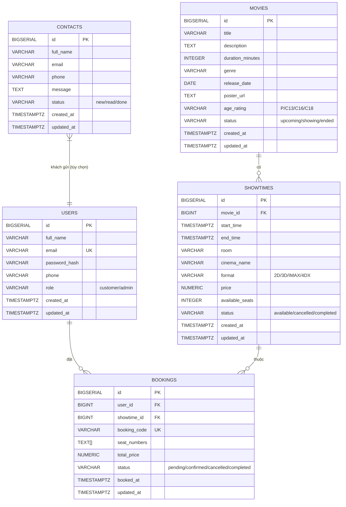
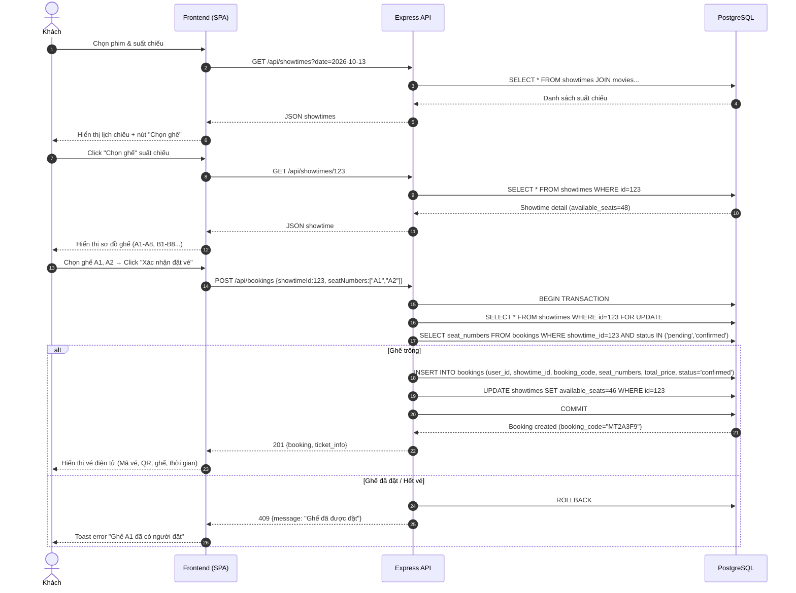
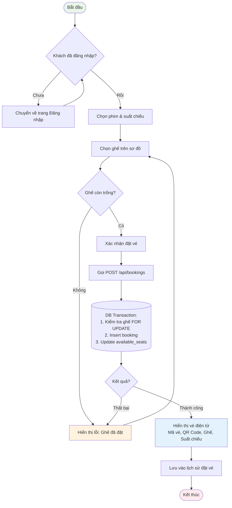
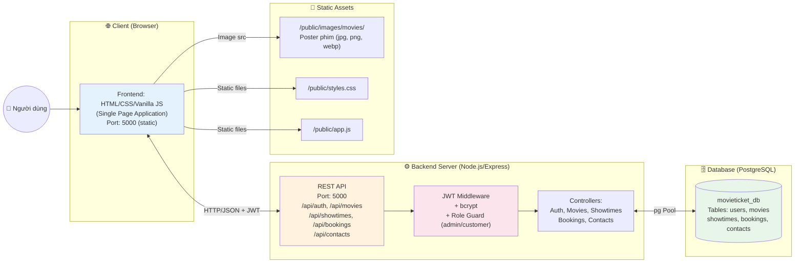
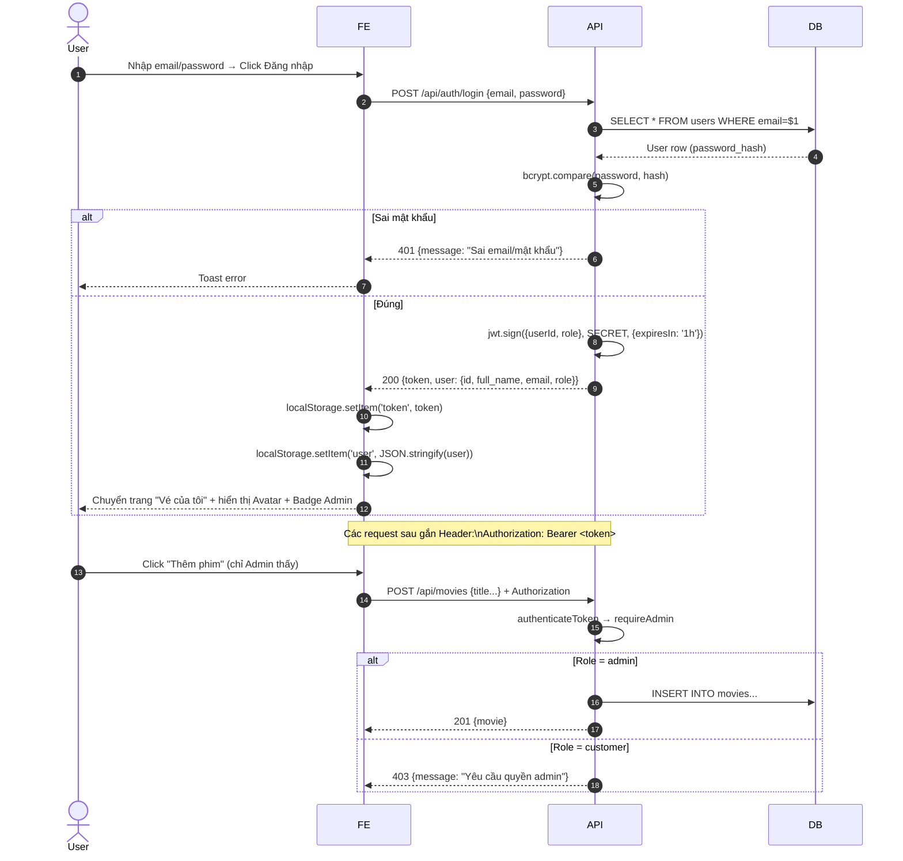

# 5 Sơ Đồ Bắt Buộc - MovieTicket2

Copy từng block dưới vào **draw.io** (Arrange → Insert → Advanced → Mermaid) hoặc **Mermaid Live Editor** → Xuất PNG → Chèn vào Word.

---

## 1. Use Case Diagram (Đã có)
Actor: **Khách**, **Admin**

```mermaid
useCaseDiagram
    package "MovieTicket2" {
        actor "Khách" as Khach
        actor "Admin" as Admin
        
        usecase "Đăng ký/Đăng nhập" as UC1
        usecase "Xem danh sách phim" as UC2
        usecase "Xem lịch chiếu" as UC3
        usecase "Chọn ghế & Đặt vé" as UC4
        usecase "Xem lịch sử vé/In vé" as UC5
        usecase "Gửi liên hệ" as UC6
        
        usecase "Quản lý phim (CRUD)" as UC7
        usecase "Quản lý suất chiếu (CRUD)" as UC8
        usecase "Quản lý liên hệ" as UC9
        usecase "Xem thống kê" as UC10
    }
    
    Khach --> UC1
    Khach --> UC2
    Khach --> UC3
    Khach --> UC4
    Khach --> UC5
    Khach --> UC6
    
    Admin --> UC1
    Admin --> UC7
    Admin --> UC8
    Admin --> UC9
    Admin --> UC10
```

---

## 2. ERD - Sơ Đồ Thực Thể Liên Kết (Entity Relationship Diagram)



---

## 3. Sequence Diagram - Luồng Đặt Vé (Booking Flow)



---

## 4. Activity Diagram - Quy Trình Nghiệp Vụ Đặt Vé



---

## 5. Architecture / Deployment Diagram - Kiến Trúc Hệ Thống



---

## 6. (Bonus) Sequence Diagram - Luồng Đăng Nhập/Phân Quyền



---

## 📸 Checklist Xuất Hình Ảnh (5 ảnh)

| # | Sơ đồ | File xuất | Chèn vào Word ở mục |
|---|-------|-----------|---------------------|
| 1 | Use Case | `usecase.png` | 2.1 Phân tích yêu cầu |
| 2 | ERD | `erd.png` | 3.1 Thiết kế CSDL |
| 3 | Sequence Đặt Vé | `seq-booking.png` | 3.2 Luồng xử lý chính |
| 4 | Activity Đặt Vé | `activity-booking.png` | 3.3 Quy trình nghiệp vụ |
| 5 | Architecture | `architecture.png` | 3.4 Kiến trúc hệ thống |

> **Mẹo**: Dùng [Mermaid Live Editor](https://mermaid.live/) → Paste code → Settings → Theme: `default` → Download PNG (2x scale cho nét).